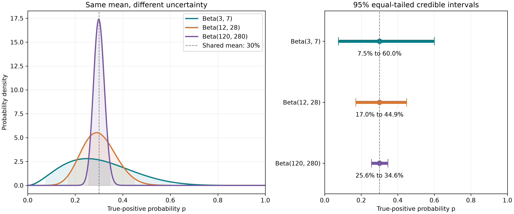

* Chapter 4: Mathematical Modeling for Threat Hunting
#+SUBTITLE: A Bayesian Approach to Learning from Alerts Chapter 4: Mathematical Modeling for Threat Hunting
#+SUBTITLE: A Bayesian Approach to Learning from Alerts Title
#+begin_quote
“Do not follow what you have no ˹sure˺ knowledge of.”
#+end_quote
— Qur'an, Surah Al-Isra, 17:36

** Case
In today’s world of AI, where information disguised as knowledge is available at our fingertips, I believe we need a strong reason to spend time learning new skills. That is why I am adding this section before the introduction: to answer a fair question from the reader—why should you invest your time in this chapter?

Many tasks today may no longer deserve as much time spent on their manual execution. I call these “aesthetic skills”: tasks that we can delegate to AI while retaining the understanding needed to judge the result. Manually writing a simple loop in Python is one example. A capable AI can usually generate it from a clear prompt. However, the user still needs to understand how the loop works to validate its implementation. With AI assistance, manually writing a simple or nested loop may be optional; understanding its behavior remains necessary.

The same reasoning applies to probabilistic modeling. In the security domain, AI can generate code to estimate how many alerts in the next batch might be malicious. But we should be able to ask: What assumptions does this model make? Why was a particular distribution chosen for the prior? How does the model connect the unknown probability to the alerts we observe? How are our beliefs updated when new evidence arrives? Code alone does not settle these questions.

To solve a problem, we first need to understand its relevant aspects and the question we are trying to answer. My argument is that, even when AI is available to help, using it effectively requires an understanding of these fundamentals. Probabilistic modeling helps us identify unknown quantities, express uncertainty through a prior, and describe how observations depend on those quantities through a likelihood. We can then update our beliefs using evidence and make predictions while acknowledging what we still do not know.

These are the decisions we will explore in this chapter. You do not need to begin with every formula memorized. Bring a security problem you want to understand, and we will work through the reasoning and code together, one step at a time. The aim is to help you build a model, question its assumptions, and judge what its results actually tell you.

** Introduction
Mathematical modeling is the process of representing a real-world problem using mathematical ideas, relationships, and assumptions. We translate the relevant aspects of the problem into mathematical terms, work with that representation, and check whether the results provide useful answers to the original question. This mathematical representation is what we call a “model.”

A model does not need to reproduce every detail of reality. It should capture the aspects that matter for the question we want to answer. For example, suppose we want to describe the waiting time until the next failed login attempt on a server. If we assume that attempts occur independently at a constant average rate, an exponential distribution can represent the waiting time. With an average rate of two attempts per minute, the expected waiting time is half a minute. This does not mean an attempt occurs exactly every thirty seconds; individual waiting times will vary. If attempts arrive in bursts or their rate changes substantially, we would need to reconsider whether this model is appropriate.

In this chapter, we will work through the essential steps of building a simple Bayesian model for a cybersecurity problem. We will start with:

1. Defining the question, identifying the unknown quantity, and stating our assumptions.
2. Selecting a suitable prior distribution to express our initial uncertainty.
3. Choosing a likelihood to describe how the observed data depends on the unknown quantity.
4. Updating our beliefs as new evidence becomes available.
5. Examining the uncertainty in our estimates.
6. Predicting future observations and checking those predictions against new evidence.

We will follow these steps through a practical security example, connecting the reasoning to the code as we go.

Let’s begin.

 
** Understanding Bayesian Probability

The Bayesian approach allows us to update the probability of a hypothesis \(H\) as new data \(D\) becomes available. This update follows Bayes’ theorem:

\[
P(H \mid D) = \frac{P(H)\,P(D \mid H)}{P(D)}
\]

The left-hand side can be read as “the probability of the hypothesis, given the observed data.” The terms are interpreted as follows:

- **\(P(H)\) — Prior:** The probability assigned to the hypothesis before observing the data.
- **\(P(H \mid D)\) — Posterior:** The updated probability of the hypothesis after observing the data.
- **\(P(D \mid H)\) — Likelihood:** The probability of observing the data if the hypothesis is true. When considered as a function of the hypothesis for fixed observed data, this is called the likelihood.
- **\(P(D)\) — Evidence:** The overall probability of observing the data, accounting for the possible hypotheses and their prior probabilities. It acts as a normalizing constant, ensuring that the posterior probabilities sum to one.

In simple words, the Bayesian approach updates our initial belief about a hypothesis using observed evidence. This is useful in cybersecurity, where we often begin an investigation with a hypothesis and revise our assessment as new events come to light.

For example, we might begin with the hypothesis that a server is compromised and communicating with an attacker-controlled system. While examining network and process logs, we notice repeated connections at regular intervals to an unfamiliar IP address rarely seen in the environment. We also find a PowerShell process executing a suspicious command.

These observations may strengthen our hypothesis, but we should also ask how likely they would be on an uncompromised server. Scheduled tasks, monitoring agents, and legitimate administration can produce superficially similar activity. Evidence supports a hypothesis when it is more likely under that hypothesis than under the alternatives.

Suppose we initially assign a 5% probability to the server being compromised. The network evidence might raise that probability, and the process evidence might raise it further. However, we cannot simply add a fixed percentage for each suspicious observation. The size of each update depends on how likely the evidence is under competing hypotheses. We must also account for relationships between observations so that we do not count the same information twice.

This example is simplified to introduce the idea. Later in this chapter, we will work through a practical example showing how to express our assumptions and update our beliefs systematically.

** Process of Mathematical Modeling

In this section, we will work through the essential steps of modeling a real-world problem. We will use a challenge familiar to many SOC teams: predicting how many alerts generated by a detection rule will be true positives in a future batch.

The proportion of true positives is an important measure of a rule’s precision. It helps SOC managers understand how much of the rule’s alert volume represents genuine malicious activity. Rules that generate a large volume of false positives can increase analysts’ workload and contribute to alert fatigue. These rules may need investigation and fine-tuning. However, a low true-positive count alone does not make a rule ineffective; it may detect an important but rare attack.

Likewise, a rule with high precision gives analysts greater confidence that its alerts warrant investigation, but precision alone should not determine severity. The potential impact of the detected activity and its context also matter. We should therefore treat precision as one measure of detection quality, alongside coverage, missed threats, and investigation cost.

Let us see how we can approach this problem using a mathematical model, one step at a time.

*** Identifying the Unknown

The first step is to understand the problem at hand and identify the unknown quantity—our quantity of interest.

Suppose we have a SOC detection rule called \(R\). Analysts have reviewed a set of its alerts and classified them as true positives or false positives. The observed precision is:

\[
\text{Observed precision} = \frac{TP}{TP + FP}
\]

Here, \(TP\) is the number of true-positive alerts and \(FP\) is the number of false-positive alerts. Multiplying this ratio by 100 expresses it as a percentage. For this example, we assume that all alerts in the reviewed sample have reliable classifications.

If analysts confirm 6 true positives among 20 reviewed alerts, the observed precision is 30%. However, this does not guarantee that exactly 30% of the next batch will be true positives.

Our primary unknown is \(p\): the probability that an alert generated by rule \(R\) is a true positive under the conditions we are modeling. The reviewed alerts provide evidence about this probability, but a limited sample does not tell us its exact value.

Once we have estimated \(p\) and expressed our uncertainty about it, we can address the practical question: how many true positives might we see in the next batch of, say, 20 alerts?

We therefore have two connected tasks: learning the unknown probability \(p\), and using that knowledge to predict a future true-positive count. We will begin with the first.

*** Identify the observations and state assumptions

The next step is to identify what we observe and state the assumptions behind our model. In our example, an observation is one reviewed alert, classified as either a true positive or a false positive. We will represent a true positive as =1= and a false positive as =0=.

For this simple model, we assume that the classifications are reliable, the reviewed alerts represent the rule's output, and each alert has the same unknown probability \(p\) of being a true positive. We also assume that alert outcomes are independent given \(p\). These assumptions may not always hold in practice. For example, several alerts could originate from the same incident.

To understand the process, let us first generate some synthetic observations. For the simulation, we will set the true-positive probability to 30%. Here, we know this probability because we are creating the data ourselves. In a real investigation, \(p\) would be unknown, and we would try to learn about it from reviewed alerts.

This simulation setting is different from a /prior/. A prior expresses our initial uncertainty about the unknown \(p\), which we will introduce in the next section.

Let us simulate the first batch of 20 alerts:

#+begin_src python
import numpy as np

rng = np.random.default_rng(42)

# Probability used to generate the synthetic alerts.
p = 0.3

random_values = rng.random(20)
#+end_src

This code creates an array of 20 uniformly distributed random values between 0 and 1, excluding 1. These values are a way to generate random outcomes; they are not separate estimates of each alert's true-positive probability.

Because approximately 30% of uniformly generated values fall below 0.3, we classify values below this threshold as true positives:

#+begin_src python
batch_1 = (random_values < p).astype(int)

print("Simulated alert labels:", batch_1)
#+end_src

The array now contains only =1= and =0= values. We can count the true and false positives:

#+begin_src python
TP = int(batch_1.sum())
FP = len(batch_1) - TP
#+end_src

The observed precision is the number of true positives divided by the total number of alerts:

\[
\text{Observed precision} = \frac{TP}{TP + FP}
\]

#+begin_src python
precision = TP / len(batch_1)

print("True positives:", TP)
print("False positives:", FP)
print(f"Observed precision: {precision:.1%}")
#+end_src

With this seed, the batch contains 4 true positives and 16 false positives, giving an observed precision of 20%.

Why is it 20% when we used a probability of 30%? Because a 30% probability does not guarantee exactly 6 true positives in every batch of 20. Random variation can produce different counts across batches even when the underlying probability stays the same.

As new reviewed batches arrive, we will update our belief about \(p\). This does not necessarily mean that \(p\) itself has changed. For now, our model assumes a fixed probability under comparable conditions; later, we will discuss when that assumption needs to be reconsidered.

*** From Prior to Posterior: Our First Update.

After setting up our basic assumptions, we now move towards an important step in the modeling process: choosing distributions that represent our uncertainty and describe how the observations might be generated.

Whenever we approach a modeling problem, it is useful to ask: how might this data have been generated in the first place? What kind of process could produce observations like these?

However, we need to distinguish two questions:

1. What do we believe about the unknown quantity before observing the current data?
2. If we knew that quantity, how would we describe the observations?

The first question guides our choice of /prior/. The second guides our choice of /likelihood/.

The following table provides some starting points. These are candidates rather than automatic rules; we must also consider their assumptions.

| Question                                                        | Candidate distribution |
|-----------------------------------------------------------------+------------------------|
| Is one reviewed alert a TP or an FP?                              | Bernoulli              |
| How many TPs occur among a fixed number of alerts?                | Binomial               |
| How many events occur within a fixed time window?                 | Poisson                |
| How long until the next event in a constant-rate Poisson process? | Exponential            |
| How can we express uncertainty about a probability?               | Beta                   |

For our example, we need to describe both the unknown true-positive probability \(p\) and the alert outcomes that depend on it. These have different roles, so they need not use the same distribution.

**** Choosing the prior

Our unknown quantity \(p\) is the probability that an alert from the rule is a true positive. Since a probability lies between 0 and 1, we need a prior distribution defined over that range.

The Beta distribution is a useful choice. It can represent many different beliefs about \(p\), and it provides a convenient update when paired with Bernoulli or Binomial observations.

We write:

\[
p \sim \operatorname{Beta}(\alpha, \beta)
\]

Here, \(\alpha\) and \(\beta\) are positive /shape parameters/. You can imagine them as two knobs that control the shape of the distribution:

- Increasing \(\alpha\), while keeping \(\beta\) fixed, shifts belief towards higher values of \(p\).
- Increasing \(\beta\), while keeping \(\alpha\) fixed, shifts belief towards lower values of \(p\).
- Increasing both proportionally keeps the mean unchanged while reducing the spread.

The mean of a Beta distribution is:

\[
E[p] = \frac{\alpha}{\alpha + \beta}
\]

For this example, we will begin with:

\[
p \sim \operatorname{Beta}(1, 1)
\]

This particular Beta distribution is uniform over the interval from 0 to 1: equal-length intervals receive equal prior probability. It is a simple starting choice, rather than a claim that it is the best prior for every detection rule.

Its mean is 0.5, but that does not mean we know the rule produces 50% true positives. The distribution expresses broad uncertainty about \(p\).

Remember that the 30% probability used earlier was a setting for generating our synthetic data. We will treat that value as hidden from the model and let the observed labels provide evidence about it.

Although \(\alpha\) and \(\beta\) are related to counts during updating, they are not simply the numbers of observed TPs and FPs. They begin as prior settings. With this model, observed TP counts are added to \(\alpha\), and observed FP counts are added to \(\beta\). We will work through that update in the next section.

Whatever its shape, the total area under the Beta density curve remains one. The area over an interval represents the probability that \(p\) lies within that interval.

**** Choosing the likelihood

The prior describes our uncertainty about \(p\). We now need to describe how the alert labels depend on \(p\).

For one reviewed alert, there are two possible outcomes:

- \(Y_i = 1\): the alert is a true positive.
- \(Y_i = 0\): the alert is a false positive.

A Bernoulli distribution describes this binary outcome:

\[
Y_i \mid p \sim \operatorname{Bernoulli}(p)
\]

In simple words, if we knew \(p\), an alert would have probability \(p\) of being a TP and probability \(1-p\) of being an FP.

If we group \(n\) alerts into a batch and count the TPs, we can use a Binomial distribution. Let \(K\) be the number of TPs:

\[
K \mid p \sim \operatorname{Binomial}(n, p)
\]

This assumes that the alerts share the same \(p\) and that their outcomes are independent given \(p\).

The probability of observing exactly \(k\) TPs among \(n\) alerts is:

\[
P(K=k \mid p)
=
\binom{n}{k} p^k (1-p)^{n-k}
\]

The term \(\binom{n}{k}\) counts the possible arrangements of \(k\) TPs among \(n\) alerts. You do not need to memorize this formula to follow the example.

Once we observe the batch, we hold its counts fixed and consider how this expression changes with \(p\). In this role, it is the /likelihood/: it tells us how well different values of \(p\) explain the observed outcome. It is not, by itself, a probability distribution over \(p\).

In our first simulated batch, we observed 4 TPs among 20 alerts. Its Binomial likelihood is therefore:

\[
L(p) = \binom{20}{4} p^4 (1-p)^{16}
\]

We now have the two ingredients needed for Bayesian updating:

- A Beta prior describing our initial uncertainty about \(p\).
- A Binomial likelihood connecting \(p\) to the observed TP count.

Combining them will give us the posterior: our updated belief about \(p\) after reviewing the batch.

*** Simulating the Prior and Likelihood
Following code simulates the uncertainty of the prior and likelihood of observing the data under hypothesis.

#+begin_src python
import numpy as np

rng = np.random.default_rng(42)

# 1. Simulate reviewed alerts.
# This probability is known to us as the data generator,
# but we treat it as unknown when fitting the model.
p = 0.3
batch_1 = (rng.random(20) < p).astype(int)

TP = int(batch_1.sum())
FP = len(batch_1) - TP

# 2. Choose the prior: Beta(1, 1).
alpha_prior = 1
beta_prior = 1

prior_samples = rng.beta(
    alpha_prior, beta_prior, size=10_000
)

# 3. Incorporate the observed counts.
# Beta prior + Binomial likelihood gives this exact update.
alpha_posterior = alpha_prior + TP
beta_posterior = beta_prior + FP

posterior_samples = rng.beta(
    alpha_posterior, beta_posterior, size=10_000
)

# 4. Summarize the result.
observed_precision = TP / len(batch_1)

posterior_mean = alpha_posterior / (
    alpha_posterior + beta_posterior
)

lower, upper = np.percentile(
    posterior_samples, [2.5, 97.5]
)

print("Alert labels:", batch_1)
print(f"TP: {TP}, FP: {FP}")
print(f"Observed precision: {observed_precision:.2%}")
print(f"Posterior: Beta({alpha_posterior}, {beta_posterior})")
print(f"Posterior mean: {posterior_mean:.2%}")
print(f"95% credible interval: {lower:.2%} to {upper:.2%}")
#+end_src

**** Interpreting the posterior and credible interval

We begin with a uniform Beta prior by setting both \(\alpha\) and \(\beta\) to 1. From this distribution, we draw 10,000 possible values of the unknown true-positive probability \(p\). These draws represent our initial uncertainty; they are not additional alert observations.

Next, we update \(\alpha\) and \(\beta\) using the reviewed batch of 20 alerts. We add the observed TP count to \(\alpha\) and the FP count to \(\beta\). We then draw 10,000 possible values of \(p\) from the resulting posterior distribution.

We calculate the observed precision as the number of TPs divided by the total number of reviewed alerts. Separately, we calculate the posterior mean, which summarizes our updated estimate of the rule's true-positive probability:

\[
E[p \mid D]
=
\frac{\alpha_{\text{posterior}}}
{\alpha_{\text{posterior}}+\beta_{\text{posterior}}}
\]

We also calculate a 95% equal-tailed credible interval. Its boundaries leave 2.5% of the posterior probability below the interval and 2.5% above it. Given our model, prior, and observations, this interval contains 95% of the posterior probability for \(p\).

As we collect more relevant, representative evidence, our uncertainty generally decreases. The posterior may shift as well as become more concentrated. However, neither a narrower interval nor an unchanged mean is guaranteed after every individual update.

To see the concentration effect clearly, let us compare three Beta distributions with the same mean but different parameter sizes:

| Distribution  | Mean |
|---------------+------|
| Beta(3, 7)    |  30% |
| Beta(12, 28)  |  30% |
| Beta(120, 280)|  30% |

All three distributions have a mean of 30%. However, as \(\alpha\) and \(\beta\) increase proportionally, the standard deviation decreases and the credible interval becomes narrower.

These are illustrative distributions, not successive updates from our original 20-alert batch. We should never multiply the parameters simply to make our model appear more certain; actual updates must be supported by evidence.

Also, increasing the number of simulation draws does not narrow the underlying distribution. It only improves our numerical approximation of that distribution.

#+CAPTION: Beta distributions with a shared mean of 30%, showing how increasing alpha and beta proportionally narrows the 95% credible intervals.
#+ATTR_HTML: :alt Three Beta distributions with mean 30%: Beta(3,7) has the widest spread, Beta(12,28) is narrower, and Beta(120,280) has the narrowest 95% credible interval.

*** Updating the Belief

So far, we have updated our initial belief using the first batch of reviewed alerts. But observations do not stop after one batch. As more alerts are reviewed, we can use the new evidence to update our belief again.

Let us simulate another batch of 20 alerts using the same underlying true-positive probability of 30%. As before, this probability is known to us because we are generating the data. Our model learns from the resulting TP and FP counts.

An important point here is that we do not start again from Beta(1, 1). The posterior from the first batch becomes the prior for the second batch. This allows us to retain what we have already learned.

The update follows the same rule:

\[
\alpha_2 = \alpha_{\text{posterior}} + TP_2
\]

\[
\beta_2 = \beta_{\text{posterior}} + FP_2
\]

The following code continues from the previous example, where =rng=, =alpha_posterior=, and =beta_posterior= have already been defined.

#+begin_src python
# 1. Generate the second batch of synthetic alert labels.
p_simulation = 0.3
batch_2 = (rng.random(20) < p_simulation).astype(int)

tp_2 = int(batch_2.sum())
fp_2 = len(batch_2) - tp_2

# 2. Summarize our belief before incorporating this batch.
previous_mean = alpha_posterior / (
    alpha_posterior + beta_posterior
)

# 3. Add only the new evidence to the previous posterior.
alpha_2 = alpha_posterior + tp_2
beta_2 = beta_posterior + fp_2

# 4. Draw possible values of p from the updated posterior.
updated_posterior_samples = rng.beta(
    alpha_2,
    beta_2,
    size=10_000,
)

# 5. Calculate the updated mean and credible interval.
updated_posterior_mean = alpha_2 / (alpha_2 + beta_2)

lower_2, upper_2 = np.percentile(
    updated_posterior_samples,
    [2.5, 97.5],
)

batch_2_precision = tp_2 / len(batch_2)

# 6. Compare the new batch with our accumulated belief.
print("Second batch of alert labels:", batch_2)
print(f"True positives: {tp_2}")
print(f"False positives: {fp_2}")
print(f"Second-batch observed precision: {batch_2_precision:.2%}")
print(f"Previous posterior mean: {previous_mean:.2%}")
print(f"Updated posterior: Beta({alpha_2}, {beta_2})")
print(f"Updated posterior mean: {updated_posterior_mean:.2%}")
print(
    f"Updated 95% credible interval: "
    f"{lower_2:.2%} to {upper_2:.2%}"
)
#+end_src

The observed precision of the second batch describes that batch alone. The updated posterior, however, incorporates our original prior and the evidence from both batches.

If the second batch's observed precision is higher than our previous posterior mean, the updated mean moves upwards. If it is lower, the mean moves downwards. The amount of movement depends on how much new evidence we have relative to the evidence already incorporated.

The updated posterior mean is one summary of our belief. The full posterior distribution also describes the uncertainty that remains. Drawing 10,000 samples helps us explore that distribution; those samples are not additional reviewed alerts.

Since we are continuing to use the same random generator, the second batch depends on which random operations were executed earlier. Your exact TP count may differ if you rerun cells or change the number of earlier draws. Run the examples in order from the beginning for reproducible results.

When a third batch arrives, we will continue from =alpha_2= and =beta_2=. In this way, each update retains the evidence incorporated so far, assuming the batches remain suitable for the same model.

*** Predicting the next batch of alerts

Updating our belief is an ongoing process. As new reviewed alerts become available, we can incorporate their outcomes into our model. In practice, incorrect labels, duplicate records, and changes in the underlying process need attention before we update. Handling these issues fully is outside our current discussion, but we should keep them in mind when working with real data.

With our updated belief, we can now move to another important part of modeling: predicting future observations.

Let us ask a practical question: how many true positives might we see in the next batch of 20 alerts?

Our posterior mean gives an estimate of the true-positive probability. Multiplying it by 20 gives the expected TP count for that batch. However, this does not mean every batch will contain exactly that number of TPs.

There are two sources of uncertainty to consider:

1. We do not know the exact true-positive probability \(p\).
2. Even if we knew \(p\), the number of TPs would vary between batches.

We can account for both by generating possible future outcomes in two steps. First, we draw a possible value of \(p\) from our updated Beta posterior. Then, using that value, we draw a TP count from a Binomial distribution:

\[
p^{(s)} \sim \operatorname{Beta}(\alpha_2, \beta_2)
\]

\[
K_{\text{next}}^{(s)} \sim \operatorname{Binomial}(20, p^{(s)})
\]

Here, \(s\) identifies one simulation, and \(K_{\text{next}}^{(s)}\) is the TP count in that simulated future batch. Repeating these steps gives us a /posterior predictive distribution/.

The following code continues from the previous section, using =alpha_2= and =beta_2=.

#+begin_src python
# 1. Set the size of the future batch and simulation.
future_batch_size = 20
number_of_simulations = 100_000

# A separate generator makes this prediction reproducible
# for the same posterior parameters.
prediction_rng = np.random.default_rng(123)

# 2. Draw plausible values of the unknown TP probability.
possible_probabilities = prediction_rng.beta(
    alpha_2,
    beta_2,
    size=number_of_simulations,
)

# 3. Generate one future TP count for each sampled probability.
future_tp_counts = prediction_rng.binomial(
    n=future_batch_size,
    p=possible_probabilities,
)

# 4. Calculate the expected count and simulated average.
posterior_mean = alpha_2 / (alpha_2 + beta_2)
expected_tp_count = future_batch_size * posterior_mean
simulated_average = future_tp_counts.mean()

# 5. Estimate the probability of a specific future outcome.
probability_at_least_8 = (future_tp_counts >= 8).mean()

# 6. Summarize the predictive distribution with integer bounds.
# These empirical quantiles select actual simulated counts.
sorted_counts = np.sort(future_tp_counts)

lower_index = int(np.ceil(0.025 * number_of_simulations)) - 1
upper_index = int(np.ceil(0.975 * number_of_simulations)) - 1

lower_count = int(sorted_counts[lower_index])
upper_count = int(sorted_counts[upper_index])

print("First 10 simulated TP counts:", future_tp_counts[:10])
print(f"Future batch size: {future_batch_size}")
print(f"Expected TP count: {expected_tp_count:.2f}")
print(f"Simulated average TP count: {simulated_average:.2f}")
print(
    f"Chance of at least 8 TPs: "
    f"{probability_at_least_8:.2%}"
)
print(
    f"Approximate 95% predictive interval: "
    f"{lower_count} to {upper_count} TPs"
)
#+end_src

Each value in =future_tp_counts= represents the number of TPs in one possible future batch of 20 alerts. These are alternative outcomes for the next batch, rather than newly observed evidence.

The simulated average should be close to the expected TP count. The expected count can be fractional, even though every individual batch contains a whole number of TPs.

The expression =(future_tp_counts >= 8).mean()= estimates the chance of observing at least eight TPs. The comparison produces =True= or =False= for each simulated batch. Taking the mean treats these as 1 and 0, giving the fraction of simulations that meet the condition.

We also report a predictive interval for the future TP count. This differs from the credible interval discussed earlier: the credible interval describes uncertainty about \(p\), while the predictive interval describes possible counts in a future batch. Because counts are discrete, the predictive interval may contain more than 95% of the predictive probability.

Our predictions assume that the future alerts follow the same process as the reviewed alerts. A change in the rule, environment, or alert population may require us to reconsider that assumption.

Finally, we must not add these simulated TP counts to \(\alpha_2\) or \(\beta_2\). They are predictions generated by our model. When the next real batch has been reviewed, we can compare its outcome with our prediction and then use the new evidence to update our belief.

*** Check predictions and revisit assumptions

So far, we have worked with simulated data. This allows us to test our implementation and compare predictions with new simulated batches generated under known conditions. However, it does not establish how well the model will perform on real SOC data.

The next step is to compare our predictions with observations that were not used to build or update the model. We should make each prediction before incorporating the new batch, then compare it with the reviewed outcome. Repeating this process across several batches gives us a more useful assessment than checking a single result.

If the observations repeatedly differ from what our model predicts, we should investigate why. Are the labels reliable? Are duplicate or related alerts affecting the results? Has the detection rule or the environment changed? These questions help us decide whether to improve the data, revisit our assumptions, or choose a more suitable model.

The aim is not to adjust values until every observation agrees with our prediction. It is to understand where the model is useful, where it falls short, and whether changes improve its predictions on fresh data.

We have covered a fair amount of ground in this post, so this is a good place to pause. In the next part of this chapter, I plan to add a practical demo using historical security data and walk through this evaluation process.

Modeling does not end with a prediction. We compare it with what happens, question our assumptions, and continue learning from new evidence.

** Summary

In this chapter, we started with a practical SOC question: how many alerts in a future batch might be true positives? We identified the unknown true-positive probability, stated our assumptions, and selected a Beta prior with a Binomial likelihood.

Using simulated alert data, we updated our belief across batches and examined the uncertainty that remained. We then used the posterior to predict future TP counts, distinguishing uncertainty about a probability from variation in the outcomes we might observe.

The purpose of this exercise was to understand the decisions behind a model, from defining the question to interpreting its predictions. A model's usefulness depends on the quality of its evidence and the suitability of its assumptions. In the next part, we will move towards a practical demonstration using historical security data and examine how the predictions compare with later observations.

** Note on AI assistance

I used ChatGPT as a learning and editing tool while developing this chapter. It helped refine the language, clarify statistical concepts, identify technical errors, and develop and check parts of the example code. The chapter grew from my own study and drafts, and I take responsibility for the material presented here.

The examples use simulated data and should not be interpreted as evidence of performance in a real SOC environment.
